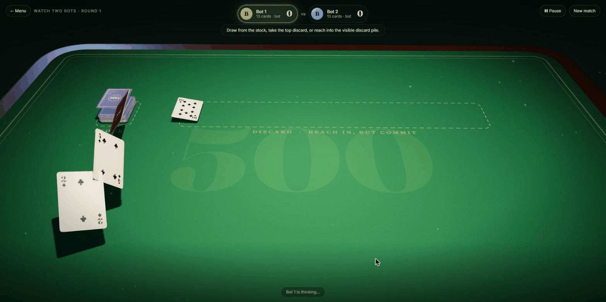
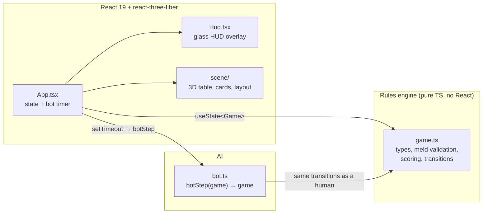

<div align="center">

# ♠ Rummy 500 ♥

### The two-player card game where reaching into the discard pile is a *promise*.

**[▶ Play it now: two-player-rummy-500.netlify.app](https://two-player-rummy-500.netlify.app)**



<sub>Two bots playing a round. Real game, real rules engine, no video editing.</sub>


</div>

---

## The hook

In most rummy games the discard pile is a graveyard: you see the top card and the rest is gone. In this version **the whole pile is spread face up**, and you may reach down as far as you like.

There's a catch, and it's a good one:

> Take a buried card and you take **every card on top of it** too. And the card you went in for **must be played in a brand-new meld before you're allowed to discard.**

That single rule turns the discard pile into a public memory game, a temptation engine, and a small act of brinkmanship. Grabbing six cards to complete a run is a great move right up until you can't complete it, and then you're stuck holding the lot. 😬

## Three ways to play

| Mode | What it is |
| --- | --- |
| 🂡 **Play the bot** | You against a rule-aware computer opponent. |
| 🂱 **Two players** | Pass-and-play on one screen. Between turns the next hand stays face-down until its player taps **Show my hand**. |
| 🃁 **Watch two bots** | Sit back. Both hands are revealed and you watch them scheme. |

## How to play

**Goal:** be the first to go out by discarding your last card, and score points from melds along the way.

### The deal
Each player gets **13 cards**. One card is flipped to start the discard pile; the rest is the stock.

### A turn: draw, meld, discard

1. **Draw**: take the top of the **stock**, the **top discard**, or reach into the **buried discard pile**.
2. **Meld** *(optional)*: lay down any valid melds from your hand, or **lay off** cards onto any meld already on the table (yours or your opponent's). Laid-off cards score for you.
3. **Discard**: put one card on the pile to end your turn.

### Melds

| Type | Rule | Example |
| --- | --- | --- |
| **Set** | 3 or 4 cards of the same rank, all different suits | `7♣ 7♦ 7♠` |
| **Run** | 3 or more consecutive cards of the **same suit** | `4♥ 5♥ 6♥ 7♥` |

Aces are **low** in runs (`A 2 3` is fine, `Q K A` is not).

### The buried-card commitment

```text
Discard pile:   3♣  9♦  [J♥]  4♠  K♦  2♣     (top of pile is on the right)
                        ▲
                        └── you reach in here

You take:       J♥ 4♠ K♦ 2♣   (the card you wanted, plus everything above it)
You must:       play J♥ in a NEW meld before discarding
If you can't:   you've just bought a very heavy hand
```

Taking the **top** discard has no strings attached. Only the buried reach is a commitment.

### Scoring

| Card | Points |
| --- | --- |
| Ace | **15** |
| K, Q, J, 10 | **10** |
| 2 – 9 | Face value |

At the end of a round each player scores **the value of their melds on the table minus the value of the cards still in their hand**. Scores carry across rounds, and the deal alternates. First to **500** wins the match. Going out early is great; getting caught holding aces is not.

The round also ends if the stock runs dry and nobody can move.

## A little history

Rummy 500 belongs to the **rummy family**, a sprawling tribe of "collect sets and runs" card games. The exact origins are murky, and card-game historians argue about them, but the family tree is usually traced through the **Mexican game Conquian** and spread across the early 20th century, giving us **Gin Rummy** (1909) and **Canasta** (1939). Rummy games caught on because all they need is a standard deck and a table.

**500 Rummy** (a.k.a. *Pinochle Rummy* or *500 Rum*) stands out for a few ideas:

- **Cumulative scoring**: play to **500 points** across many rounds, hence the name.
- **A visible discard pile**: unlike Gin, the discards are spread out and you can dig for what you need.
- **Melds are assets, your hand is a liability**: laid-down cards score for you; cards left in hand count against you.

It became a kitchen-table staple, especially in North America, because it rewards *memory*, *risk assessment*, and a small amount of cheerful cruelty. House rules vary enormously from family to family. This project models the buried-discard commitment variant often played in Canada: dive as deep as you like, but you must use the card you dove for.

> The match ends when a round finishes with at least one player on 500 or more; the higher total wins. If both are level at 500+, play continues.

## Under the hood

A deliberately small codebase (about 2,000 lines) with a clean separation between **rules**, **AI**, and **presentation**.



### Design decisions worth a look

- **The engine is a bag of pure functions.** Every transition has the shape `(game: Game, ...args) => Game`: `drawFromStock`, `takeFromDiscard`, `playMeld`, `discardFromHand`, `scoreRound`. There's no mutation, no React and no I/O, so the entire game is trivially inspectable (and testable).
- **The buried-discard rule is a data structure, not an `if`.** Taking a buried card sets a `DrawLock` on the game. `playMeld` clears it only if the locked card is in the meld; `discardFromHand` refuses to run while it's set. Humans and bots both go through the same gate, so nobody can cheat by accident.
- **The bot plays by the same rules as you.** `botStep` performs exactly *one* action per call using the public transitions. It evaluates each possible reach into the discard pile, simulates whether it can meld the target card, and only dives when the net points are positive. A `useEffect` + `setTimeout` loop in `App.tsx` paces it so you can follow along.
- **The 3D table is just a view of `Game`.** [`react-three-fiber`](https://r3f.docs.pmnd.rs/) renders cards as meshes with textures painted at runtime on a canvas (`cardArt.ts`), with no image assets. Cards animate between positions as the game state changes.
- **Responsive 3D.** `layout.ts` computes landscape and portrait card layouts, so the table also works on phones.
- **No backend.** All state lives in React. The deployed site is static files on Netlify.

### Project structure

```text
src/
  game.ts            Cards, meld validation (classifyMeld), scoring, pure turn transitions
  bot.ts             Bot player: meld planning, discard-pile valuation, discard choice
  App.tsx            Mode select, match state, bot turn timer
  Hud.tsx            Glass-morphism HUD: scores, status, controls, menu
  scene/
    Stage.tsx        Canvas, camera, table, lighting
    MatchScene.tsx   Maps Game state to 3D cards
    CardMesh.tsx     A single animated card
    cardArt.ts       Procedurally painted card faces and backs
    layout.ts        Landscape/portrait positions for every pile and hand
```

## Run it locally

```bash
npm install
npm run dev        # Vite dev server
npm run build      # type-check (tsc -b) + production build
npm run lint       # Oxlint
npm run preview    # serve the production build
```

There is no test runner yet; the strict TypeScript build is the safety net.

## Roadmap

These are natural next steps rather than bugs:

- [ ] Jokers / wild cards
- [ ] Configurable ace behaviour (high, low, or both)
- [ ] Strict "must discard to go out" house-rule toggle
- [ ] Calling "Rummy" on a missed playable discard
- [ ] Online multiplayer
- [ ] Saved match history
- [ ] Unit tests for the rules engine (the pure-function design makes this cheap)

## Tech stack

React 19 · TypeScript · Vite · Three.js via react-three-fiber · Oxlint · hosted on Netlify

## License

No license has been selected yet.
